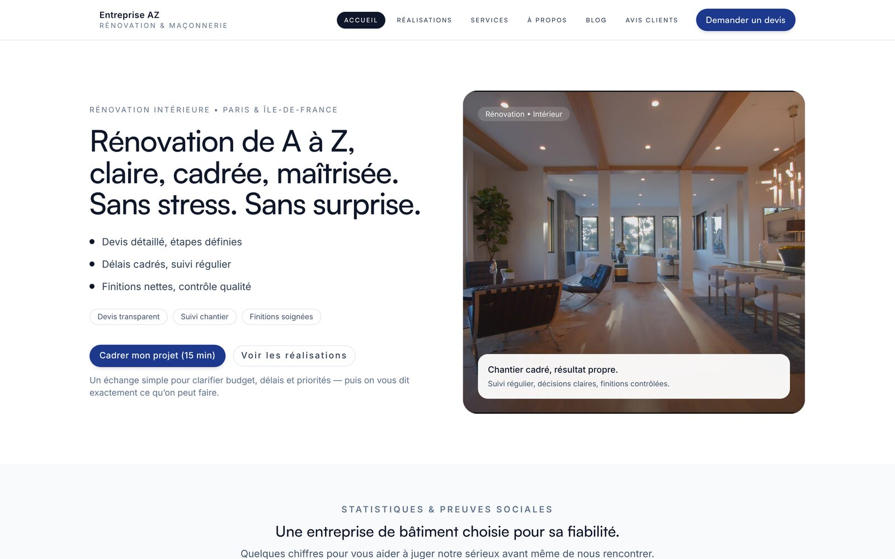

<div align="center">

# 🏗️ Entreprise AZ — Renovation company website

**Conversion-focused showcase website for a French interior renovation company (Paris & Île-de-France).**

[](https://renovation-az.netlify.app)
[](https://github.com/lindasad3/Construction-Company-Website/actions)




</div>

---

## Context

Renovation is a **high-anxiety purchase**: clients fear hidden costs, delays and sloppy finishes.
The brief was to build a site that **reassures first, then converts** — turning visitors into quote requests.

## Conversion & UX strategy

| Visitor objection | Answer on the page |
|---|---|
| "Will it cost more than announced?" | Promise of a **detailed quote with defined steps**, "transparent quote" trust chip |
| "Will it drag on?" | **Process steps** section, scheduled follow-up |
| "Are they serious?" | **Stats & social proof** section, client reviews page |
| "Have they done projects like mine?" | **Latest realisations** (Haussmannian flat, bathroom, carpentry, restaurant…) |
| "What do I do next?" | Single primary CTA everywhere: **"Request a quote"** + a low-commitment "Scope my project (15 min)" |

## Features

- ✨ Animated hero (GSAP timeline: per-character title reveal, staggered groups, media)
- 🧱 Services: bathroom, kitchen, interior renovation, electricity, plumbing, masonry, pools
- 🖼️ Realisations gallery and dedicated page
- ⭐ Client reviews, About and Blog pages
- 📬 Contact page with quote-request form (front-end)
- 🧩 Reusable UI kit (`Button`, `Card`, `ReviewCard`, `SecondaryLink`)
- 🔎 SEO basics: French `lang`, title & meta description, canonical, Open Graph
- 🔁 SPA routing with Netlify redirects (`public/_redirects`)

## Getting started

```bash
git clone https://github.com/lindasad3/Construction-Company-Website.git
cd Construction-Company-Website
npm install
npm run dev        # http://localhost:5173
```

| Script | Description |
|---|---|
| `npm run dev` | Start the dev server |
| `npm run build` | Production build in `dist/` |
| `npm run preview` | Preview the production build |
| `npm run lint` | ESLint |

## Project structure

```
src/
├── Components/
│   ├── pages/        # Home, Services, Réalisations, À propos, Blog, Avis clients, Contact
│   ├── ui/           # Button, Card, ReviewCard, SecondaryLink
│   └── *.jsx         # Hero, StatsSection, ProcessSteps, LatestRealizations, Services, Navbar, Footer…
├── data/             # services, realizations, reviews (content separated from UI)
└── assets/font/      # Satoshi (self-hosted)
```

## Deployment

Deployed on **Netlify** (build command `npm run build`, publish directory `dist`).
`public/_redirects` sends every route to `index.html` so deep links work.

## Roadmap

- [ ] Connect the quote form to a backend (Netlify Forms / email service)
- [ ] `LocalBusiness` JSON-LD, `sitemap.xml` and `robots.txt`
- [ ] Pre-rendering for better indexing of each page
- [ ] Image optimisation (WebP/AVIF + `srcset`)

---

<div align="center">

Designed & built by **[Lynda Sadoudi](https://github.com/lindasad3)** — Dev × Growth

</div>
